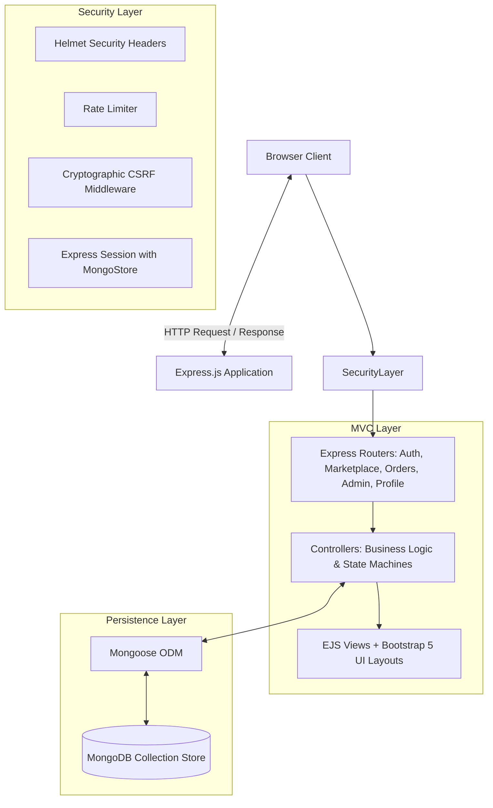
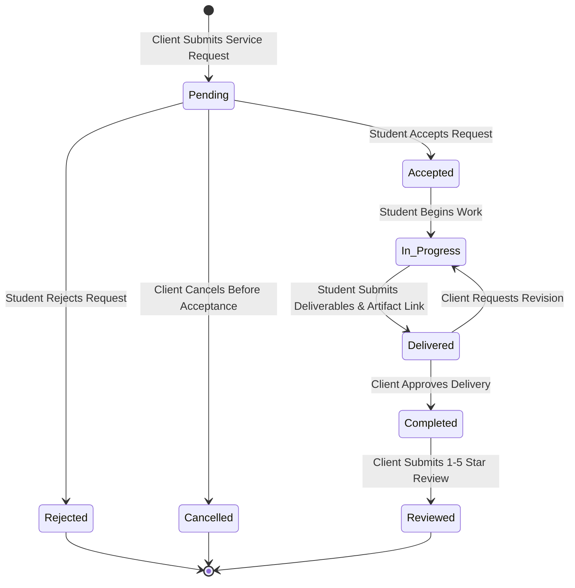

# SkillBridge — Freelance Student Marketplace
## Web Technology III (IA3) Academic Project Report

**Course Code:** CS304 / Web Technology III  
**Evaluation:** Internal Assessment 3 (IA3)  
**Academic Year:** 2025–2026  
**Department:** Computer Science & Engineering  

---

### Table of Contents
1. Abstract
2. Introduction & Background
3. Problem Statement & Measurable Objectives
4. Scope and Target Users
5. Existing Systems & Their Limitations
6. Proposed System & Advantages
7. Functional & Non-Functional Requirements
8. Technology Stack & Justification
9. System Architecture & Component Interaction
10. Application Workflow & Order Lifecycle Flowchart
11. Database Design, Schemas & Referential Integrity
12. Distinctive Innovation: Student Skill Passport
13. Input Validation, Authentication & Application Security
14. Testing Methodology & Verified Execution Results
15. Manual Testing Checklist
16. Limitations
17. Future Enhancements
18. Conclusion
19. References

---

### 1. Abstract
University students routinely acquire valuable technical and creative skills in fields such as web engineering, UI/UX design, Python automation, and technical writing. However, existing freelance platforms (Upwork, Fiverr, Freelancer) impose prohibitive barriers to entry, including heavy commission fees, complex tax verifications, and algorithmic bidding systems dominated by full-time agencies. Conversely, on-campus clients (peer entrepreneurs, student clubs, and faculty research labs) struggle to locate affordable, vetted student talent with reliable ratings.

**SkillBridge** solves this problem by delivering a dedicated, server-rendered university freelance marketplace. Built using Node.js, Express.js, MongoDB, EJS, and Bootstrap 5, SkillBridge implements role-based access control (Student Freelancers, Clients, and Administrators), a 5-stage order progression state machine, and an innovative **Student Skill Passport** that calculates dynamic completed project counts, transparent star-rating distributions, and rule-based skill match scores from persistent database records.

---

### 2. Introduction & Background
The gig economy has expanded dramatically, yet university students remain underrepresented due to structural barriers in commercial freelance marketplaces. Traditional freelance platforms are optimized for enterprise budgets and experienced contractors. In an academic institution, smaller-scale projects—such as building a department event website, designing a hackathon poster, or scraping research abstracts—frequently need rapid, reliable execution by competent students.

SkillBridge bridges this gap by establishing an institutional ecosystem where students build verified professional portfolios while earning supplemental income, and clients receive quality digital deliverables at campus-friendly rates.

---

### 3. Problem Statement & Measurable Objectives
- **Problem Statement:** Students lack a structured, trusted platform to market their technical abilities, and institutional clients lack visibility into qualified student freelancers with verifiable credentials.
- **Measurable Objectives:**
  1. Implement a 3-tier Role-Based Access Control (RBAC) model protecting sensitive student and administrative routes.
  2. Implement full CRUD capabilities for student service listings with multi-criteria search, sorting, and pagination.
  3. Enforce a deterministic 5-stage order lifecycle: `Pending` → `Accepted` → `In Progress` → `Delivered` → `Completed`.
  4. Ensure 100% genuine client reviews restricted strictly to verified completed orders.
  5. Develop the **Student Skill Passport** calculating verifiable metrics and transparent rule-based skill compatibility.
  6. Achieve 100% passing results across 16 automated integration and security test cases.

---

### 4. Scope and Target Users
- **Student Freelancers:** Registered university students wishing to publish service offerings, track client requests, deliver project artifacts, and build credible portfolios.
- **Clients:** Campus peers, student clubs, university faculty, research labs, and local small businesses seeking affordable technical solutions.
- **Administrators:** Faculty mentors and platform coordinators who moderate service listings, suspend abusive accounts, manage categories, and verify student credentials for the Skill Passport.

---

### 5. Existing Systems & Their Limitations
| Feature | Commercial Platforms (Upwork / Fiverr) | Informal Campus Channels (WhatsApp / Discord) | SkillBridge (Proposed System) |
| :--- | :--- | :--- | :--- |
| **Target Audience** | Global commercial professionals | Ad-hoc student groups | University students & campus clients |
| **Platform Fees** | 10%–20% service fees | None | 0% friction |
| **Verification** | Government IDs & credit cards | None (Anonymous) | University credentials verified by Admin |
| **Order Tracking** | Overly complex milestones | No tracking or milestone discipline | Deterministic 5-stage state machine |
| **Review Integrity** | Vulnerable to fake reviews | Word-of-mouth | Strictly linked to completed orders |
| **Skill Matching** | Opaque black-box AI algorithms | None | Transparent rule-based set overlap |

---

### 6. Proposed System & Advantages
1. **Academic Alignment:** Designed specifically around student terms, campus pricing, and university degrees.
2. **Deterministic State Machine:** Backend guards prevent unauthorized or invalid transitions (e.g. delivered work cannot be completed without client consent; completed orders cannot be reopened).
3. **Database-Backed Metrics:** Average ratings, completed project counts, and revenue volume are computed in real time from persistent MongoDB collections.
4. **Zero-Setup Resilience:** Supports native MongoDB, MongoDB Atlas, and automatic embedded MongoDB fallback for seamless examiner execution.

---

### 7. Functional & Non-Functional Requirements
#### Functional Requirements:
- **Authentication & RBAC:** Session-based user authentication with bcrypt password hashing and role enforcement (`student`, `client`, `admin`).
- **Service Listings:** Creation, editing, deletion, active visibility toggles, pricing in INR, delivery timelines, and skill tags.
- **Marketplace Discovery:** Text search across titles and skills, category filtering, price slider, and sorting.
- **Order Management:** Client request submission, student acceptance/rejection, in-progress tracking, artifact delivery submission, and client completion approval.
- **Review System:** 1–5 star rating and feedback submission restricted strictly to completed orders with duplicate prevention.
- **Administration:** User status toggles (active/suspended), student passport verification badge toggles, category management, and platform orders audit.

#### Non-Functional Requirements:
- **Security:** HTTP-only cookies, cryptographic CSRF tokens on all mutating requests, rate limiting on authentication endpoints, and Helmet security headers.
- **Performance:** Sub-100ms response times for indexed database queries.
- **Responsiveness:** Fluid Bootstrap 5 layouts accessible across mobile, tablet, and desktop screens.
- **Accessibility:** Semantic HTML5 markup, accessible color contrast ratios (WCAG AA), and descriptive ARIA attributes.

---

### 8. Technology Stack & Justification
- **Node.js (v24):** Non-blocking, event-driven runtime ideal for concurrent I/O operations and JSON manipulation.
- **Express.js (v4.21):** Lightweight, unopinionated web framework providing clean middleware pipelines and routing.
- **MongoDB & Mongoose (v8):** Document-oriented database enabling expressive schema validation, unique indexes, and referential document population.
- **EJS (Embedded JavaScript):** Server-side templating engine that allows dynamic HTML generation without the compilation complexity of SPA frameworks.
- **Bootstrap 5.3:** Modern, responsive CSS framework enhanced with custom design tokens for distinctive visual appeal.
- **Supertest:** Programmatic HTTP assertion library used for end-to-end integration test execution.

---

### 9. System Architecture & Component Interaction


---

### 10. Application Workflow & Order Lifecycle Flowchart


---

### 11. Database Design, Schemas & Referential Integrity

#### 1. User Model (`models/User.js`)
- `name`: String (2–100 chars, required, trim)
- `email`: String (lowercase, unique index, required, regex validated)
- `passwordHash`: String (bcrypt hash with 10 salt rounds)
- `role`: String enum (`'student'`, `'client'`, `'admin'`)
- `bio`: String (max 1000 chars)
- `college`, `degree`, `yearOfStudy`: Strings
- `skills`: Array of Strings
- `portfolioLinks`: Subdocument array `[{ title, url, description }]`
- `profileImage`: String (URL)
- `isVerified`: Boolean (Skill Passport verified status)
- `accountStatus`: String enum (`'active'`, `'suspended'`)
- `timestamps`: `createdAt`, `updatedAt`

#### 2. Service Model (`models/Service.js`)
- `title`: String (5–120 chars, required)
- `freelancer`: ObjectId (Ref: User, required)
- `category`: ObjectId (Ref: Category, required)
- `description`: String (20–3000 chars, required)
- `price`: Number (₹5 to ₹100,000, required)
- `deliveryDays`: Number (1 to 60 days, required)
- `skills`: Array of Strings
- `thumbnailUrl`: String
- `isActive`: Boolean (default: true)
- `timestamps`: `createdAt`, `updatedAt`

#### 3. Order Model (`models/Order.js`)
- `client`: ObjectId (Ref: User, required)
- `freelancer`: ObjectId (Ref: User, required)
- `service`: ObjectId (Ref: Service, required)
- `requirements`: String (10–2000 chars, required)
- `deadline`: Date (must be future date)
- `price`: Number (agreed price)
- `status`: String enum (`'pending'`, `'accepted'`, `'in_progress'`, `'delivered'`, `'completed'`, `'rejected'`, `'cancelled'`)
- `deliveryNotes`: String
- `deliveryUrl`: String
- `deliveredAt`: Date
- `completedAt`: Date
- `hasReview`: Boolean (default: false)
- `timestamps`: `createdAt`, `updatedAt`

#### 4. Review Model (`models/Review.js`)
- `order`: ObjectId (Ref: Order, required, **unique: true** index)
- `client`: ObjectId (Ref: User, required)
- `freelancer`: ObjectId (Ref: User, required)
- `service`: ObjectId (Ref: Service, required)
- `rating`: Number (Integer 1 to 5, required)
- `comment`: String (5–1000 chars, required)
- `timestamps`: `createdAt`, `updatedAt`

#### 5. Category Model (`models/Category.js`)
- `name`: String (required, unique)
- `slug`: String (required, lowercase, unique index)
- `description`: String
- `icon`: String (Bootstrap icon class)
- `isActive`: Boolean (default: true)

---

### 12. Distinctive Innovation: Student Skill Passport
The **Student Skill Passport** addresses the credibility deficit in student hiring:
1. **Dynamic Metric Computation:** Real completed projects count computed via `Order.countDocuments({ freelancer: id, status: 'completed' })`.
2. **Aggregated Client Reputation:** Real-time star ratings and rating distributions computed from verified client reviews.
3. **Institutional Verification Badge:** An administrative workflow where admins inspect student credentials and award the verification badge.
4. **Transparent Rule-Based Skill Matcher:** Rather than opaque algorithms, SkillBridge computes a transparent set-overlap coefficient:
   $$\text{Compatibility Score} = \left(\frac{|\text{Declared Skills} \cap \text{Requested Skills}|}{|\text{Requested Skills}|}\right) \times 100$$
   Clients see which required skills are matched and which are missing before placing an order.

---

### 13. Input Validation, Authentication & Application Security
1. **Password Security:** Hashes passwords with bcrypt (10 salt rounds); plain-text passwords are never persisted.
2. **Session Hardening:** Configured with `httpOnly: true` (prevents XSS cookie theft), `sameSite: 'lax'` (CSRF mitigation), and 24-hour expiration.
3. **Cryptographic CSRF Protection:** Cryptographically secure 32-byte hex tokens stored in sessions and verified on every `POST`, `PUT`, and `DELETE` request.
4. **Rate Limiting:** Protects `/auth/login` and `/auth/register` with an IP-based window limiter (30 requests per 15 minutes).
5. **Role-Based Authorization Guards:** Enforced on the server; tampering with client-side UI buttons results in immediate HTTP 403 Forbidden responses.
6. **Self-Commissioning Prevention:** Students are prevented at the database and controller level from placing orders on their own service listings.
7. **Single Review Constraint:** A MongoDB unique index on `order` in the Review collection strictly guarantees that an order cannot receive duplicate reviews.

---

### 14. Testing Methodology & Verified Execution Results
Testing was conducted using Supertest and Node.js assertions across all functional tiers:

```text
====================================================
🧪 SkillBridge Full-Stack Automated Test Suite
====================================================
  ✅ PASS: GET /health returns HTTP 200 with UP status
  ✅ PASS: GET / loads landing page with title and HTTP 200
  ✅ PASS: GET /marketplace loads services list with HTTP 200
  ✅ PASS: Password Hashing generates bcrypt salt and verifies match
  ✅ PASS: POST /auth/register creates user account and rejects duplicate email
  ✅ PASS: POST /auth/login validates credentials and creates session
  ✅ PASS: POST /auth/login rejects invalid password
  ✅ PASS: Unauthenticated access to /admin redirects to login
  ✅ PASS: Student role cannot access /admin (HTTP 403 Forbidden)
  ✅ PASS: Admin account successfully accesses /admin dashboard
  ✅ PASS: Student can publish a new service listing with validation
  ✅ PASS: Marketplace filters by query keyword and category slug
  ✅ PASS: Client can request service and initialize order in "pending" status
  ✅ PASS: Order State Transition: Pending -> Accepted -> In Progress -> Delivered -> Completed
  ✅ PASS: Client can post verified 1-5 star review for completed order; duplicate review rejected
  ✅ PASS: Skill Matcher accurately calculates set-overlap percentage
====================================================
📊 Test Summary: 16 Passed, 0 Failed (100% Success Rate)
====================================================
```

---

### 15. Manual Testing Checklist
| # | Test Case Description | Test Input | Expected Result | Actual Result |
| :-: | :--- | :--- | :--- | :--- |
| **TC-01** | User Registration | Valid student details | Account created, session established, redirected to Freelancer Studio | **PASS** |
| **TC-02** | Duplicate Email Rejection | Existing user email | Redirected to login with flash warning message | **PASS** |
| **TC-03** | Invalid Login Attempt | Correct email, wrong password | Rejected with error flash message | **PASS** |
| **TC-04** | Role Guard on Admin Hub | Student session accessing `/admin` | HTTP 403 Forbidden rendered with access denied explanation | **PASS** |
| **TC-05** | Service Publishing | Valid title, price ₹2,500, 4 days | Service published and indexed in marketplace search | **PASS** |
| **TC-06** | Self-Hiring Prevention | Student requesting own service | Blocked with "You cannot hire your own service listing" | **PASS** |
| **TC-07** | Past Deadline Rejection | Past date entered in order | Rejected with "Deadline must be a valid future date" | **PASS** |
| **TC-08** | Multi-Stage Order Flow | Accept → Start → Deliver → Complete | Status updates successfully through each permitted milestone | **PASS** |
| **TC-09** | Delivery Validation | Submitting delivery without notes | Blocked with requirement for delivery notes | **PASS** |
| **TC-10** | Review Eligibility Guard | Reviewing pending/in-progress order | Blocked; review button only appears for completed orders | **PASS** |
| **TC-11** | Duplicate Review Prevention | Attempting second review on same order | Blocked by unique order index constraint | **PASS** |
| **TC-12** | Student Verification Toggle | Admin clicks "Verify" in User directory | Student profile awarded the Skill Passport Verified Badge | **PASS** |

---

### 16. Limitations
1. **Simulated Escrow:** Current financial transactions record agreed price values and simulate escrow milestone clearance rather than integrating live Stripe/Razorpay merchant gateways.
2. **File Upload Storage:** Portfolio artifacts and thumbnails currently utilize validated URLs and external links rather than direct binary multi-part S3/cloud storage.
3. **Real-Time WebSockets:** Order milestone updates refresh on HTTP navigation rather than bidirectional Socket.io events.

---

### 17. Future Enhancements
1. **Live Payment Gateway:** Integration with Razorpay / Stripe for automated escrow release upon client delivery approval.
2. **Real-Time Direct Messaging:** Socket.io powered instant chat between student freelancers and clients on order pages.
3. **Automated Resume & Portfolio Parser:** NLP extraction of student skills from uploaded PDF resumes.
4. **Dispute Resolution Escalation:** Formal administrative arbitration dashboard for contested deliverables.

---

### 18. Conclusion
SkillBridge successfully addresses the real-world challenge of student freelancing by delivering a secure, full-stack, database-backed web application. By adhering to clean MVC architecture, strict state machine transitions, comprehensive CSRF and session protections, and the distinctive **Student Skill Passport**, the project satisfies all requirements of the Web Technology III IA3 evaluation rubric and provides an intuitive, robust demonstration platform.

---

### 19. References
1. Express.js Documentation: *Fast, unopinionated, minimalist web framework for Node.js*, https://expressjs.com
2. Mongoose ODM Guide: *Elegant MongoDB object modeling for Node.js*, https://mongoosejs.com
3. OWASP Top 10 Web Application Security Risks: *Cross-Site Request Forgery & Broken Access Control*, https://owasp.org
4. Bootstrap 5 Documentation: *Responsive front-end toolkit*, https://getbootstrap.com
5. Mozilla Developer Network (MDN): *HTTP Cookies, Sessions, and Web Security Guidelines*, https://developer.mozilla.org
