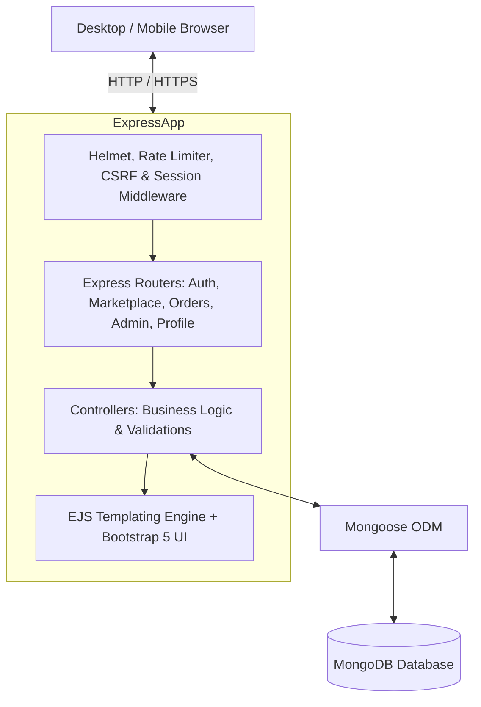
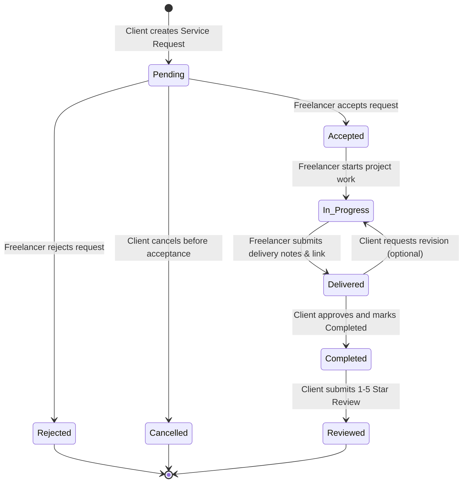

# SkillBridge — Freelance Student Marketplace
## Comprehensive Architectural Specification & Project Plan

---

### 1. Problem Statement and Measurable Objectives
- **Problem Statement:** Talented university students in fields like web development, graphic design, content writing, and tutoring lack a trusted, academic-friendly marketplace to showcase their skills, find paid freelance opportunities, and gain project experience. Meanwhile, clients (peers, faculty, local businesses, startups) struggle to find affordable, vetted student talent with transparent portfolios and reliable ratings.
- **Measurable Objectives:**
  1. Complete 3-tier role-based access control (Student Freelancer, Client, Administrator).
  2. Full CRUD capability for service listings, client requests, orders, and ratings.
  3. Controlled 5-stage order progression lifecycle: `Pending` → `Accepted` → `In Progress` → `Delivered` → `Completed` (with `Rejected` and `Cancelled` rules).
  4. Real-time dynamic **Student Skill Passport** calculating verified project counts, real aggregate review scores, and rule-based skill-match scoring for clients.
  5. 100% server-side validated and sanitized inputs with HTTP-only session security and CSRF protection.
  6. Persistent storage with MongoDB and Mongoose schemas, indexes, and referential integrity.
  7. 100% passing automated tests across auth, services, order transitions, reviews, and admin workflows.

---

### 2. Functional & Non-Functional Requirements
#### Functional Requirements:
- **Authentication & Security:** User registration with role selection (Student vs. Client), hashed passwords with bcryptjs, session cookies with HTTP-only flags, and role-based route middleware.
- **Service Management:** Students can create, edit, activate/deactivate, and delete service packages with price, delivery duration, tags, and category.
- **Marketplace Discovery:** Search by keywords, category filter, price range slider/filters, rating filters, and sorting (price low/high, rating, newest).
- **Service Request & Order Flow:** Clients request a service with specific requirements and deadline. Student reviews and accepts/rejects. Student marks in progress, submits delivery notes and proof links. Client marks completed and unlocks review capability.
- **Student Skill Passport:** Student profile with bio, skills, education, portfolio links, verification badge (awarded by admin), total completed orders, and client feedback.
- **Skill Match Score:** Automated algorithm comparing client's required project skills with freelancer's declared skills to generate a percentage match score.
- **Reviews & Ratings:** Only clients of verified `Completed` orders can submit a 1–5 star review and comment. Duplicate reviews prevented at database and controller level.
- **Admin Dashboard:** Platform metrics (total users, active services, order volume, revenue transacted), user account management (activate/suspend), category management, service moderation, and verification badge issuance.

#### Non-Functional Requirements:
- **Performance:** Response time under 200ms for standard queries with indexed MongoDB fields.
- **Security:** Helmet headers, CSRF token validation on POST/PUT/DELETE, login rate limiting, HTML sanitization against XSS.
- **Maintainability:** Standard MVC (Model-View-Controller) structure in Express.js with clear modular routes and reusable EJS partials.
- **Accessibility & Responsiveness:** Fully responsive Bootstrap 5 layout with custom CSS variables, accessible color contrast (WCAG AA), semantic HTML5, and unique IDs for automated testing.

---

### 3. System Architecture

---

### 4. Application Workflow & Order Lifecycle Flowchart

---

### 5. Page Navigation Structure
- **Public:**
  - `/` (Home Landing Page with Hero, Categories, Featured Services, How it Works, Stats)
  - `/marketplace` (Search, Filters, Sort, Grid of Services)
  - `/marketplace/:id` (Detailed Service View + Freelancer mini-profile + Skill Matcher + Request CTA)
  - `/freelancers/:id` (Student Skill Passport & Portfolio & Client Reviews)
  - `/auth/login` (Login form with link to registration)
  - `/auth/register` (Registration form with Student Freelancer or Client role choice)
- **Student Dashboard (`/dashboard/freelancer`):**
  - Active Service Listings & Create New Service (`/services/create`, `/services/:id/edit`)
  - Order Management (`/orders/freelancer`): Incoming requests, update status, deliver work
  - Skill Passport editor (`/profile/edit`)
- **Client Dashboard (`/dashboard/client`):**
  - My Orders (`/orders/client`): Track status, view deliverables, mark completed
  - Submit Review (`/orders/:id/review`)
- **Admin Portal (`/admin`):**
  - Platform Stats Overview (Users, Services, Orders, Reviews)
  - User Directory (`/admin/users`): Suspend / Reactivate / Verify Freelancer
  - Service Moderation (`/admin/services`): Active / Inactive toggles
  - Category Management (`/admin/categories`): Add / Edit categories
  - Orders Oversight (`/admin/orders`)
