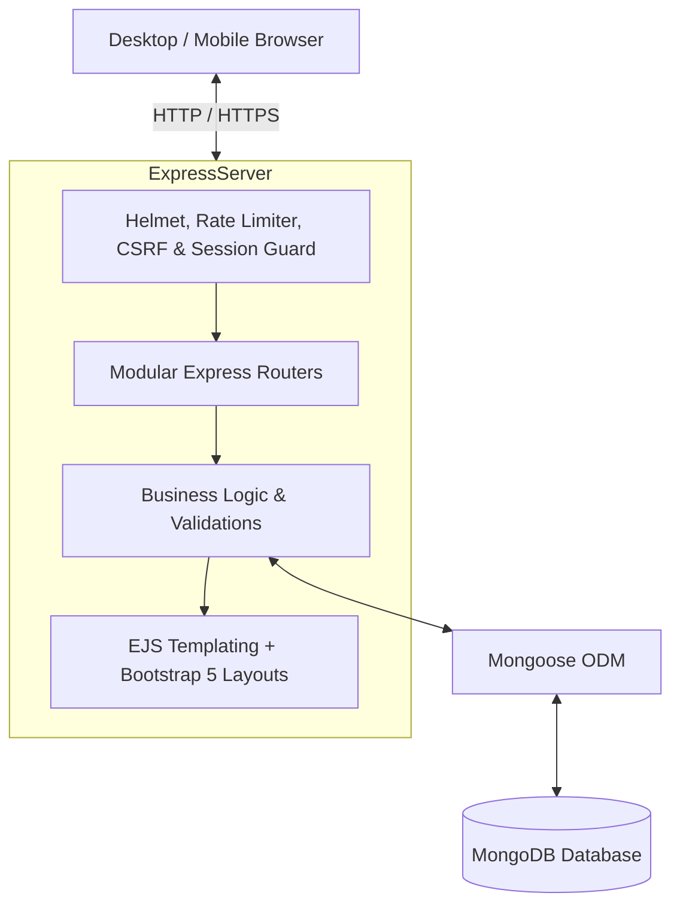
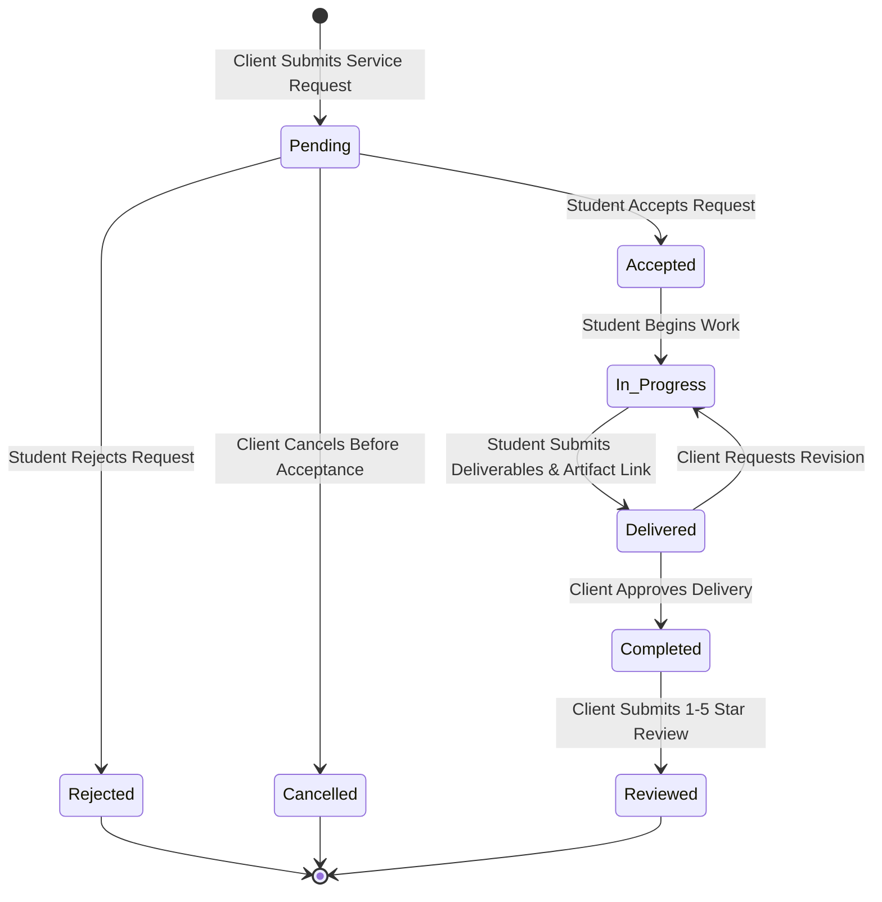

# SkillBridge — Freelance Student Marketplace

[](https://nodejs.org/)
[](https://expressjs.com/)
[](https://www.mongodb.com/)
[](https://getbootstrap.com/)
[](#automated-testing)
[](#academic-evaluation)

> **SkillBridge** is a full-stack, responsive web marketplace designed specifically for university ecosystems. It empowers talented students to publish freelance services, showcase verified portfolios, receive client project requests, track multi-stage order milestones, and build credibility through authentic reviews and the **Student Skill Passport**.

---

## 🌟 Distinctive Innovation: Student Skill Passport

Unlike conventional freelance platforms that rely on unverified claims, SkillBridge introduces the **Student Skill Passport**:
1. **Verifiable Academic Identity**: Displays university affiliation, degree program, and year of study.
2. **Administrator Verified Badge**: Awarded exclusively through an administrative audit of student credentials.
3. **Database-Backed Project Count**: Dynamically aggregates completed orders from verified MongoDB records.
4. **Authentic Rating Breakdown**: Computes 1–5 star distributions strictly from clients who commissioned and completed real orders.
5. **Rule-Based Skill Matcher**: An algorithmic set-overlap calculator `(Matched Skills / Required Skills) * 100` that transparently scores freelancer compatibility against client project requirements.

---

## 🏗️ System Architecture & Technology Stack



### Technology Highlights
- **Backend (Node.js & Express.js)**: Event-driven, asynchronous I/O runtime offering fast response times and straightforward MVC modularity.
- **Database (MongoDB with Mongoose)**: Flexible document model ideally suited for nested portfolio links, dynamic review calculations, and referential integrity. Includes automatic zero-setup embedded fallback for testing.
- **Templating (EJS + express-ejs-layouts)**: Server-rendered architecture eliminating SPA hydration overhead while keeping code understandable for academic viva demonstrations.
- **Security**:
  - `bcryptjs`: Adaptive one-way password hashing with salt rounds.
  - `express-session`: HTTP-only, SameSite session cookies.
  - Cryptographic CSRF Protection: Validates tokens on all state-mutating requests (`POST`, `PUT`, `DELETE`).
  - `helmet`: Secure HTTP response headers and Content Security Policy (CSP).
  - `express-rate-limit`: Prevents brute-force credential stuffing attacks on authentication endpoints.

---

## 👥 User Roles & Permissions

| Feature | Student Freelancer | Client | Administrator |
| :--- | :---: | :---: | :---: |
| Browse Services & Marketplace | ✅ | ✅ | ✅ |
| View Student Skill Passports | ✅ | ✅ | ✅ |
| Publish & Manage Service Listings | ✅ (Own Only) | ❌ | ✅ (Moderation) |
| Commission Project Requests | ❌ | ✅ | ❌ |
| Order State Machine Transitions | ✅ (Accept, Start, Deliver) | ✅ (Cancel, Complete) | ✅ (Oversight) |
| Submit Verified Ratings & Reviews | ❌ | ✅ (Completed Orders) | ❌ |
| Verify Student Skill Passports | ❌ | ❌ | ✅ |
| User Suspension & Category CRUD | ❌ | ❌ | ✅ |

---

## 🔄 Controlled 5-Stage Order Lifecycle



---

## ⚡ Quick Start & Setup Guide

### Prerequisites
- [Node.js](https://nodejs.org/) (v18.0.0 or higher, tested on v24.19.0)
- [npm](https://www.npmjs.com/) (v9.0.0 or higher)
- *(Optional)* Local MongoDB or MongoDB Atlas URI. If local MongoDB is not running, SkillBridge automatically starts an embedded in-memory MongoDB instance with zero configuration required.

### 1. Clone the Repository
```bash
git clone https://github.com/your-username/skillbridge.git
cd skillbridge
```

### 2. Install Dependencies
```bash
npm install
```

### 3. Configure Environment Variables
Copy `.env.example` to `.env`:
```bash
cp .env.example .env
```
Configure your server and initial administrator credentials in `.env`:
```env
PORT=3000
NODE_ENV=development
MONGODB_URI=mongodb://127.0.0.1:27017/skillbridge
USE_EMBEDDED_DB_FALLBACK=true
SESSION_SECRET=your_super_secret_session_key_here

# Initial Administrator Account Setup (used by: npm run create-admin)
ADMIN_NAME=Platform Administrator
ADMIN_EMAIL=admin@university.edu
ADMIN_PASSWORD=your_secure_admin_password
```

### 4. Seed Base Service Categories
Initialize the marketplace disciplines:
```bash
npm run seed
```
*(This seeds required base categories only. No demo users, services, or fake reviews are created).*

### 5. Create Initial Administrator Account
Set up the platform administrator using your `.env` credentials:
```bash
npm run create-admin
```
*(Public registration allows only Student Freelancers and Clients. Administrators can only be created via this secure script).*

### 6. Start the Application
```bash
npm start
```
Open your browser at **[http://localhost:3000](http://localhost:3000)**.

---

## 📝 Real Registration & Authentication Flow

1. **User Registration (`/register`):**
   - Direct link: [http://localhost:3000/register](http://localhost:3000/register)
   - Choose role: **Student Freelancer** or **Client** (no public admin registration).
   - Enter full name, valid email, and secure password (minimum 8 characters).
   - Server validates all inputs, hashes the password with bcrypt, and redirects to `/login` with a success confirmation message.
2. **User Login (`/login`):**
   - Direct link: [http://localhost:3000/login](http://localhost:3000/login)
   - Secure server-side sessions with CSRF protection and brute-force rate limiting.
   - Redirects students to their **Freelancer Studio** (`/dashboard/freelancer`), clients to their **Client Project Hub** (`/dashboard/client`), and admins to the **Administrator Hub** (`/admin`).

---

## 🧪 Automated Testing

SkillBridge includes a comprehensive automated test suite testing:
- Public routes & health endpoints
- Password hashing & verification
- User registration, minimum 8-character password enforcement, and duplicate email rejection
- Public admin role tampering rejection
- Session authentication & invalid login rejection
- Role-based authorization & 403 Forbidden handling
- Service creation & multi-criteria filtering
- Full 5-stage order workflow progression
- Review eligibility & duplicate review constraint enforcement
- Rule-based Skill Matcher mathematical correctness

Run tests anytime with:
```bash
npm test
```

### Actual Test Output
```text
====================================================
🧪 Starting SkillBridge Full-Stack Automated Test Suite
====================================================
  ✅ PASS: GET /health returns HTTP 200 with UP status
  ✅ PASS: GET / loads landing page with title and HTTP 200 (Clean Empty State support)
  ✅ PASS: GET /marketplace loads services list with HTTP 200
  ✅ PASS: GET /login and GET /register top-level aliases redirect properly
  ✅ PASS: Password Hashing generates bcrypt salt and verifies match
  ✅ PASS: POST /auth/register validates min 8-char password and rejects short passwords
  ✅ PASS: POST /auth/register rejects public admin role tampering
  ✅ PASS: POST /auth/register creates student account, rejects duplicate email, and redirects to login
  ✅ PASS: POST /auth/login validates credentials and creates session
  ✅ PASS: POST /auth/login rejects invalid password
  ✅ PASS: Unauthenticated access to /admin redirects to login
  ✅ PASS: Student role cannot access /admin (HTTP 403 Forbidden)
  ✅ PASS: Admin account successfully accesses /admin dashboard
  ✅ PASS: Student can publish a new service listing with validation
  ✅ PASS: Marketplace filters by query keyword and category slug
  ✅ PASS: Client can request service and initialize order in "pending" status
  ✅ PASS: Order State Transition: Pending -> Accepted -> In Progress -> Delivered -> Completed
  ✅ PASS: Client can post verified 1-5 star review for completed order; duplicate review rejected
  ✅ PASS: Skill Matcher accurately calculates set-overlap percentage
====================================================
📊 Test Summary: 19 Passed, 0 Failed
====================================================
```

---

## 📂 Project Organization

```text
skillbridge/
├── config/
│   └── db.js                 # Database connection & embedded fallback engine
├── controllers/
│   ├── adminController.js       # Administrative oversight & verification
│   ├── authController.js        # Authentication & session creation
│   ├── homeController.js        # Landing page & platform stats aggregation
│   ├── marketplaceController.js # Search, filter, sort, service detail
│   ├── orderController.js       # Order lifecycle state machine & dashboards
│   ├── profileController.js     # User profile & Skill Passport updates
│   ├── reviewController.js      # Rating & client review submission
│   └── serviceController.js     # Student service listing CRUD
├── middleware/
│   ├── auth.js               # Session verification & role guards
│   ├── csrf.js               # Cryptographic CSRF token verification
│   ├── locals.js             # Global template context & formatters
│   └── security.js           # Helmet headers & rate limiting
├── models/
│   ├── Category.js           # Discipline categories schema
│   ├── Order.js              # Order schema & transition validator
│   ├── Review.js             # Review schema with unique order index
│   ├── Service.js            # Freelance services listing schema
│   └── User.js               # User accounts & bcrypt password helper
├── public/
│   ├── css/styles.css        # Custom design system tokens & styles
│   ├── js/main.js            # Client-side validation & UI handlers
│   └── images/               # Vector SVG assets & avatars
├── routes/
│   ├── adminRoutes.js        # Admin endpoints
│   ├── authRoutes.js         # Register, login, logout
│   ├── homeRoutes.js         # Landing & student profile
│   ├── marketplaceRoutes.js  # Marketplace browsing
│   ├── orderRoutes.js        # Orders & role dashboards
│   ├── profileRoutes.js      # Profile editing
│   ├── reviewRoutes.js       # Review posting
│   └── serviceRoutes.js      # Service listings
├── scripts/
│   ├── seed.js               # Base category data seeding
│   └── createAdmin.js        # Secure initial admin account creation script
├── tests/
│   └── run-tests.js          # Automated end-to-end test suite
├── views/
│   ├── layouts/main.ejs      # Master HTML5 layout
│   ├── partials/             # Header, footer, dismissible alerts
│   └── pages/                # Views for every page & admin portal
├── .env.example              # Sample environment template
├── package.json              # Project dependencies & scripts
├── README.md                 # Project documentation
├── ACADEMIC_REPORT.md        # Comprehensive Web Tech III IA3 report
└── VIVA_GUIDE.md             # Oral exam preparation & Q&A
```

---

## 🎓 Academic Evaluation & Rubric Compliance

This project was built to exceed the requirements of **Web Technology III IA3**:
- **Full-Stack Execution**: Zero mock data; all views render from real MongoDB documents.
- **Robust Security**: Bcryptjs password hashing, HTTP-only session cookies, CSRF protection, and server-side input sanitization.
- **Relational Integrity**: Strict referential connections between Users, Services, Orders, and Reviews with unique compound constraints.
- **Responsive Aesthetics**: Modern typography, custom color palette, accessible contrast ratios, and glassmorphic touches.

---

## 📜 License
This project is licensed under the MIT License — created for educational and academic showcase purposes.
